<p align="center">
  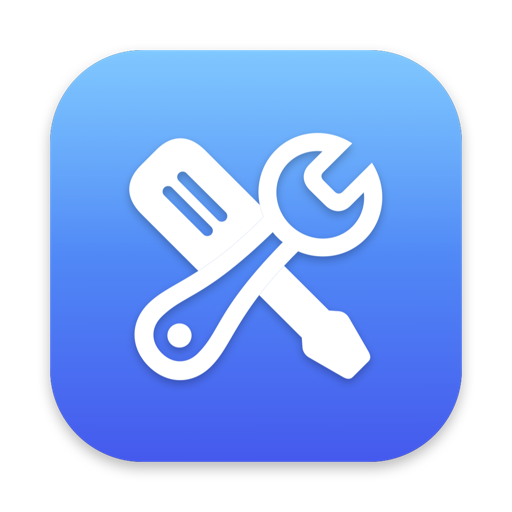
</p>

<h1 align="center">take-it-easy</h1>

<p align="center">
  <b>A macOS menu bar multitool that takes the tedious, mechanical bits out of your day.</b><br>
  OCR anything on screen · clipboard history · one-flick file actions · per-app volume · window previews · system monitor
</p>

<p align="center">
  macOS 14.2+ · Apple Silicon &amp; Intel · no network, no telemetry
</p>

---

## What it is

take-it-easy lives behind a single icon in the menu bar. Click it and you get a Control Center–style panel:
quick controls for the tools you use (volume, microphone, CPU, clipboard, keep-awake) on top, and a grid of
tiles to switch each tool on or off below. Every tool is an independent **module**: turn on only what you need,
and macOS permissions are requested only when a module that needs them is switched on, never at launch.

Everything runs locally. The app makes no network requests and collects nothing.

<p align="center">
  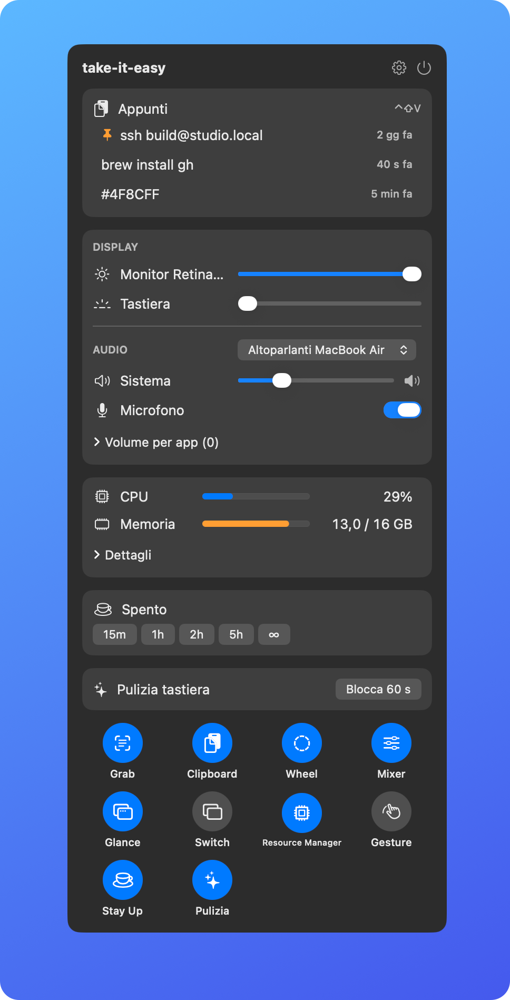
</p>

> The UI is currently in Italian.

## Modules

| | Module | What it does |
|---|---|---|
| 🔍 | **Grab** | Select any area of the screen → its text (OCR, automatic language detection) or QR code lands in the clipboard. Eyedropper copies any on-screen color as HEX. |
| 📋 | **Clipboard** | Searchable clipboard history with pinned items and paste-as-plain-text. Skips passwords copied from password managers. |
| 🎡 | **Wheel** | Select files in Finder, press the trigger, flick toward an action: images → PDF, convert, compress, resize, rotate, strip metadata, merge/split PDFs, video → MP4/GIF, zip, rename, open in Terminal… Output always goes *next to* the originals. |
| 🎚️ | **Mixer** | Per-app volume, output device, microphone mute with push-to-talk, brightness for built-in and external (DDC) displays and the keyboard backlight. |
| 🪟 | **Glance** | Hover a Dock icon → a bubble with live thumbnails of that app's windows. Click to raise, middle-click to close, type to filter. |
| 🔀 | **Switch** | Window previews on top of the system ⌘Tab, plus ⌥` to cycle the windows of the current app. |
| 📈 | **Resource Manager** | CPU (total, per core, per app), memory (total and per app), GPU, power draw, network, Bluetooth device batteries, external disks with eject. |
| ✋ | **Gesture** | Tap a modifier on its own to trigger a trackpad gesture, e.g. right ⌘ → Show Desktop. |
| ☕ | **Stay Up** | Keeps your Mac awake for 15 min, 1–5 h or indefinitely, optionally letting the display sleep. |
| ✨ | **Clean** | Locks the keyboard for a while so you can wipe it. |

## Screenshots

<table>
  <tr>
    <td align="center">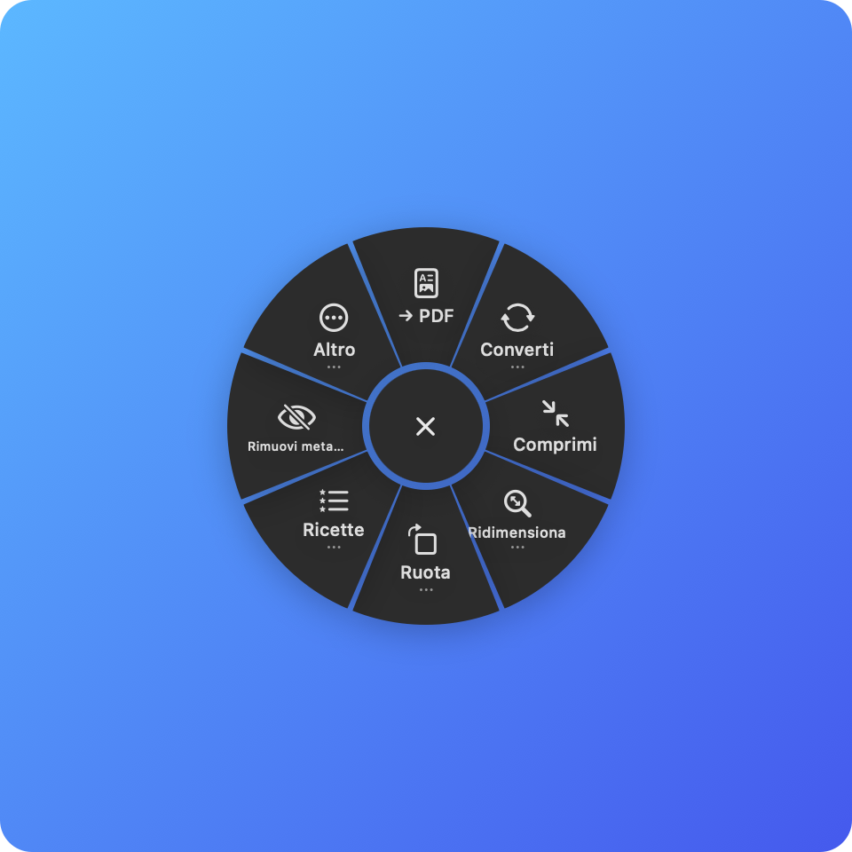<br><b>Wheel</b>: file actions around the cursor</td>
    <td align="center">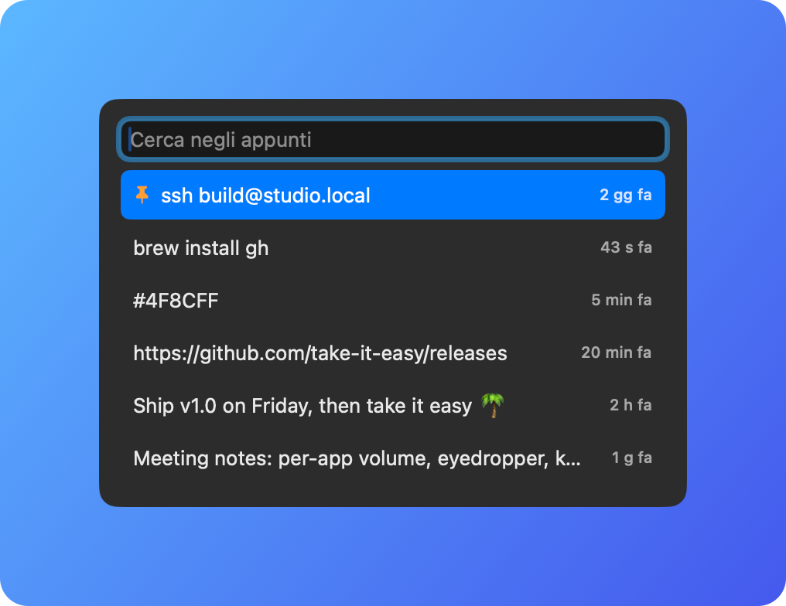<br><b>Clipboard</b>: history at the cursor, type to filter</td>
  </tr>
  <tr>
    <td align="center">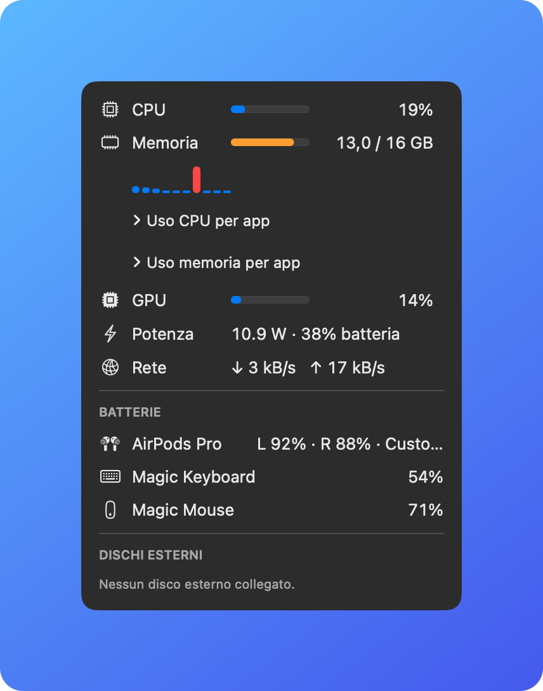<br><b>Resource Manager</b>: system at a glance</td>
    <td align="center">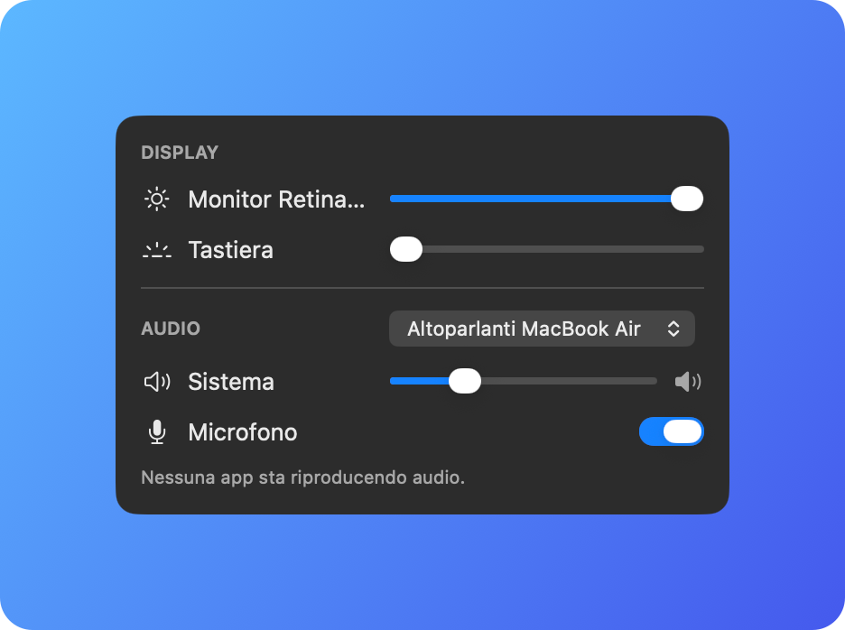<br><b>Mixer</b>: displays, keyboard, audio and microphone</td>
  </tr>
  <tr>
    <td colspan="2" align="center">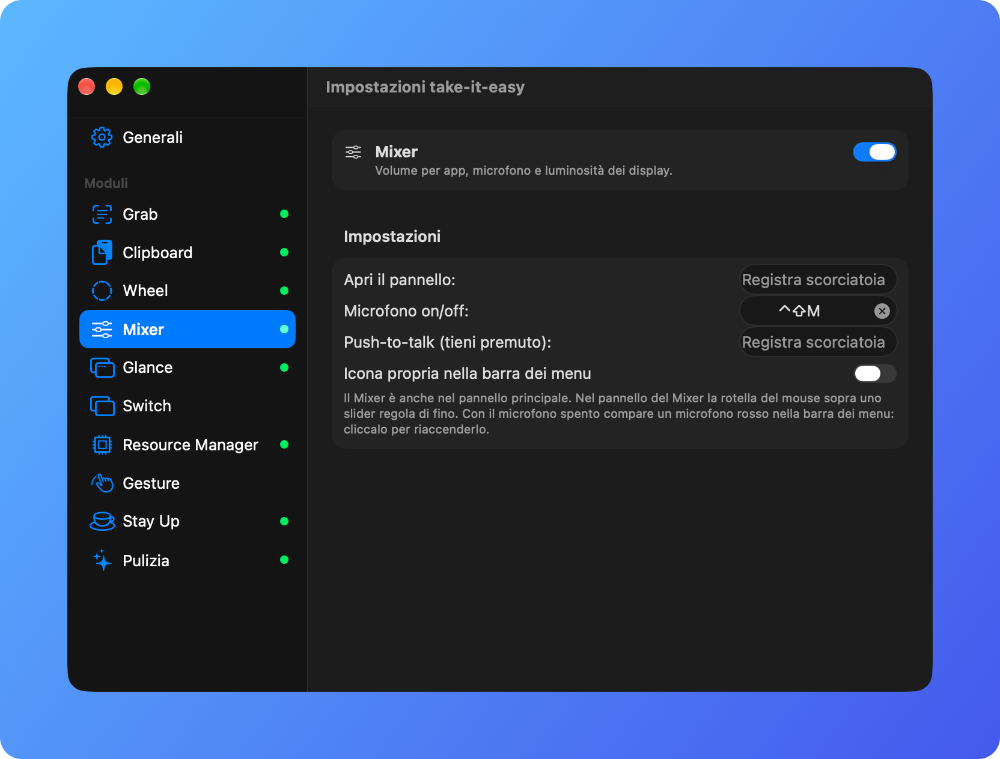<br><b>Settings</b>: one page per module</td>
  </tr>
</table>

---

## Install

1. Download `TakeItEasy-<version>.zip` from the latest [Release](../../releases) and unzip it.
2. Drag **TakeItEasy.app** into **Applications**.
3. **First launch.** The app is signed but not notarized by Apple, so macOS blocks it the first time:
   open it once and dismiss the warning, then go to **System Settings › Privacy & Security**, scroll down and click
   **Open Anyway**. Or, from Terminal:
   ```sh
   xattr -dr com.apple.quarantine /Applications/TakeItEasy.app
   ```
4. Click the 🔧 icon in the menu bar and tap the tiles of the modules you want.
5. Optional: **Settings › Generali › Avvia al login** to start it at login.

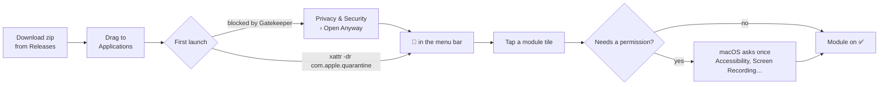

### Permissions

Each permission is requested only when you switch on a module that needs it.

| Permission | Used by | Why |
|---|---|---|
| Accessibility | Wheel, Glance, Switch, Gesture, Clipboard, Clean | read/press keys, raise windows, paste |
| Screen Recording | Grab, Glance, Switch | OCR area capture and window thumbnails |
| Automation (Finder) | Wheel | read the Finder selection |
| System Audio Recording | Mixer | per-app volume via Core Audio process taps |

### Update

Download the new version, replace the one in Applications, repeat step 3.
**Granted permissions are kept**: every release is signed with the same certificate, so macOS recognizes it as
the same app.

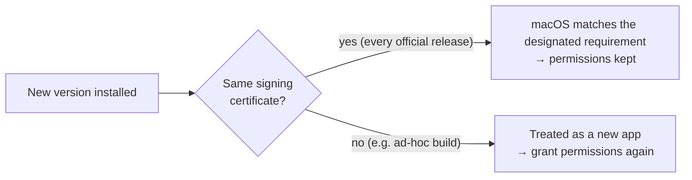

### Uninstall

Move the app to the Bin. To also remove permissions and data:
```sh
tccutil reset All russogiulio.TakeItEasy
rm -rf ~/Library/Application\ Support/take-it-easy ~/Library/Preferences/russogiulio.TakeItEasy.plist
```

---

## How it works

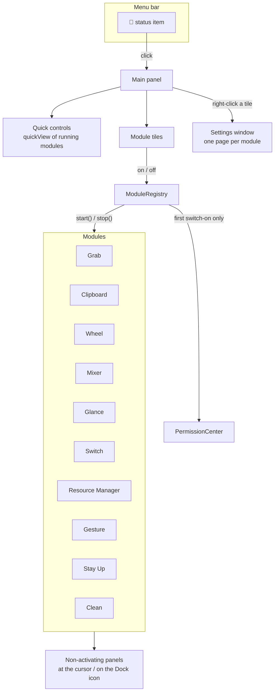

- Each module lives in `TakeItEasy/Modules/<Name>/` and implements the `TIEModule` protocol:
  idempotent `start()` / `stop()`, where `stop()` restores everything it changed (event taps removed,
  audio taps destroyed, volumes back to 100%, original brightness, microphone unmuted).
- Shared code lives in `TakeItEasy/Core/`; modules never import each other.
- Panels are non-activating `NSPanel`s, so they never steal focus from the app you're working in.
- Private APIs (DisplayServices, IOAVService for DDC, CoreBrightness) are loaded with `dlopen` and degrade
  gracefully when missing.

See [`PLAN.md`](PLAN.md) for the full design, per-module flows and roadmap.

---

## Releasing (maintainer)

One script does everything: **`scripts/release.sh <version>`**.

### One-time setup

```sh
brew install gh
gh auth login
```

That's it: the signing certificate and the GitHub repo are created by the script on its first run.

### Every release

```sh
git commit -am "…"          # the script refuses to run with uncommitted changes
scripts/release.sh 1.1
```

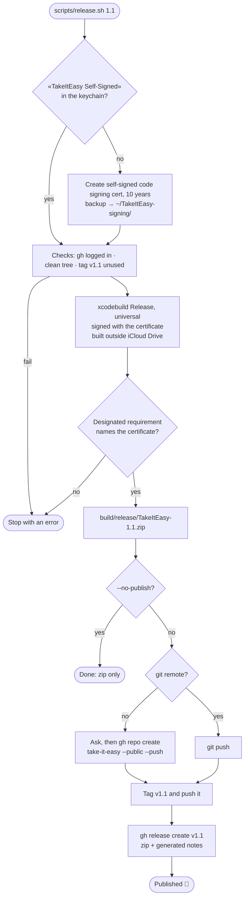

| Option | Effect |
|---|---|
| `scripts/release.sh 1.1 --no-publish` | certificate + build + zip only, GitHub untouched |
| `REPO_NAME=other scripts/release.sh 1.1` | different name for the repo created on the first run |
| `BACKUP_DIR=… P12_PASSWORD=…` | where the certificate backup goes and its password (default: generated) |

### About the certificate

Signing every release with the **same** certificate is what makes macOS remember users' permissions across
updates; no paid Apple Developer account is needed for that. Notarization (no Gatekeeper warning on first
launch) would require one.

- After the first run, **move the password** from `~/TakeItEasy-signing/password.txt` into your password
  manager and keep `signing.p12` somewhere safe (not in the repo, not in plain iCloud).
- On another Mac: double-click `signing.p12` to import it, and the script will use it.
- If you lose it, delete the old one from the keychain and rerun the script: a new certificate is created,
  and users grant permissions once more.

### Icon and screenshots

| Asset | Regenerate with |
|---|---|
| App icon (`Assets.xcassets/AppIcon`, `docs/icon.png`) | `swift scripts/make-icon.swift` |
| README screenshots (`docs/screenshots/`) | Debug build, then `open -n <DerivedData>/TakeItEasy.app --args -enabledModules "()" -TIEScreenshots "$PWD/docs/screenshots"` |

The screenshot tour (DEBUG builds only) opens each panel with demo data (no real clipboard contents or device
names), captures only the app's own windows and puts them on the icon's gradient. Don't touch the mouse while
it runs (~15 s).

---

## Development

- Xcode 16+, Swift 6 (strict concurrency, main-actor default isolation). Open `TakeItEasy.xcodeproj` and run.
- CLI build: `xcodebuild -project TakeItEasy.xcodeproj -scheme TakeItEasy -configuration Debug build`
- Only dependency: [KeyboardShortcuts](https://github.com/sindresorhus/KeyboardShortcuts).
- Project rules for contributors and AI assistants: [`CLAUDE.md`](CLAUDE.md).
- Permissions can be invalidated after a rebuild: `tccutil reset All russogiulio.TakeItEasy` and grant again.
  Xcode builds are signed with the development certificate and releases with the self-signed one,
  so on your own Mac the two "steal" permissions from each other.
